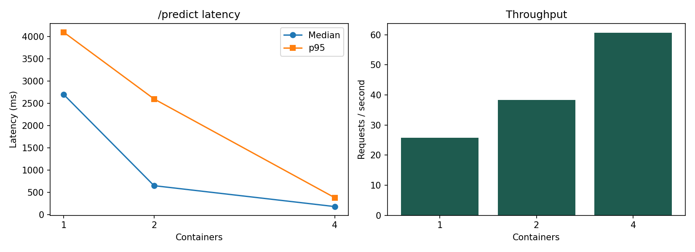

# Handwritten Digit Classifier: MLOps Pipeline

| **Video demo** |  |
| **Live app** | http://51.20.14.115:8000 |
| **API docs** | http://51.20.14.115:8000/docs |


## Project description

Many clinics and community health workers still record patient information by hand: ages, weights,
temperatures and doses written in paper registers, vaccination cards and lab forms. Turning those
numbers into digital records is slow and error-prone. This project builds the first component of a
tool that reads handwritten numbers: a model that recognises a single handwritten digit (0–9) from an image.

Because a misread dose is dangerous, the model is designed to assist, not replace, a health worker:
every prediction comes with a confidence score so uncertain readings can be checked by a person.

The project covers the full machine learning lifecycle: data acquisition and preprocessing, a
convolutional neural network, evaluation, a REST API with a monitoring dashboard, retraining on newly
uploaded data, deployment in Docker containers behind a load balancer on AWS, and load testing with Locust.

## Dataset

- **UCI / scikit-learn handwritten digits:** 1,797 images at 8×8 pixels (1,437 train, 360 test).
- **MNIST sample:** 600 training and 100 test images per digit, added so the model learns many more writing styles.
- **Total in `data/raw`:** 7,437 training images and 1,360 test images, balanced at about 745 and 136 per digit.
- **`data/train` also holds 33 demo uploads** (computer-font digits from the notebook's retraining demo, the
  12-character hex file names), so it contains 7,470 images. The shipped model was trained on all 7,470.

Every image is reduced to 8×8 (the UCI resolution) and then enlarged to 32×32 before training and prediction.
This makes MNIST digits and photos look like the UCI digits, at the cost of the finer detail in MNIST images.

## Features

- **Prediction:** draw a digit or upload a photo of one; the model returns the digit and all ten probabilities.
- **Visualisations:** class balance, digit width and the average image of each digit, each with an interpretation.
- **Model up-time:** live uptime clock of the container that answered, a response-time chart, and the container name.
- **Bulk upload:** many images of one digit, or a .zip with folders named 0–9.
- **Retraining:** a button, plus an automatic trigger once 50 new images are uploaded. A lock file ensures only
  one container retrains at a time. A retrained model goes live unless its test accuracy is more than
  1 percentage point below the current model's (`PROMOTION_TOLERANCE`, set it to 0 to require no drop).
- **Evaluation in production:** re-score the live model on the test set at any time; every version is
  listed with its accuracy.
- **Access control:** when the `API_KEY` environment variable is set, `/upload`, `/retrain` and `/evaluate`
  require it in an `X-API-Key` header (the dashboard asks for it once per visit). Prediction stays open.

## Repository structure

```text
├── README.md
├── notebook/digit_classifier.ipynb    preprocessing, training, evaluation, prediction, retraining
├── src/
│   ├── config.py                      paths and settings
│   ├── preprocessing.py               data acquisition, canonicalize(), data pipelines, uploads
│   ├── model.py                       CNN, evaluation, retraining and its trigger
│   ├── prediction.py                  single-image prediction
│   ├── api.py                         FastAPI app
│   └── static/index.html              dashboard
├── data/raw, data/train, data/test    images
├── models/digit_cnn.h5                trained model (version 5)
├── locust/                            load test and results
├── scripts/run_load_tests.sh          runs the 1/2/4-container load tests
├── scripts/summarize_locust.py        builds the load-test table and chart
├── deploy/nginx.conf                  load balancer
├── Dockerfile, docker-compose.yml
└── requirements.txt, requirements-dev.txt
```

## Setup

### Run locally (Python 3.10–3.12)

```bash
git clone https://github.com/u-kevine/Digit-Classifier-MLOps-Pipeline.git
cd Digit-Classifier-MLOps-Pipeline
python3.12 -m venv .venv && source .venv/bin/activate
pip install -r requirements-dev.txt
uvicorn src.api:app --port 8000
```

Open http://localhost:8000 for the dashboard and http://localhost:8000/docs for the API.

### Retrain the model from scratch

Run `notebook/digit_classifier.ipynb` top to bottom, or `python -m src.model train`.
Note that the notebook's last section runs a retraining demo that updates `models/digit_cnn.h5` and moves
33 demo images into `data/train`.

### Run with Docker (load-balanced)

```bash
export API_KEY=choose-a-secret            # optional locally, recommended on a public server
docker compose up -d --build
docker compose up -d --scale api=3 && docker compose restart nginx
```

### Deploy on AWS

1. Launch an EC2 instance: Ubuntu 24.04, m7i-flex.large (free-tier eligible), 30 GB disk.
2. Open TCP port 8000 in its security group.
3. Install Docker: `curl -fsSL https://get.docker.com | sudo sh`
4. Clone this repo, set `API_KEY`, and run `docker compose up -d --build`.

## Model evaluation

Metrics of the shipped model (`models/digit_cnn.h5`, version 5) on the 1,360 test images, from `models/model_meta.json`:

| Metric | Value |
|---|---|
| Accuracy | 97.4% (1,325 / 1,360) |
| Precision (macro) | 97.4% |
| Recall (macro) | 97.4% |
| F1 (macro) | 97.4% |
| Log loss | 0.084 |
| ROC-AUC (one-vs-rest, macro) | 0.999 |

Digit 8 is the hardest (127 of 135 correct, recall 94.1%); its errors are spread over 2, 9, 3, 5 and 6.

**Version history.** The notebook trained version 4 (97.7% accuracy, 1,329 / 1,360; analysed in detail in the
notebook). Its retraining demo then fine-tuned on 33 computer-font digits, producing version 5 at 97.4%. Version 5
was promoted because the 0.3-point drop is within the 1-point tolerance; it is the model in this repository.
The live site may have been retrained since with new uploads; see the version table on the dashboard.

## Flood request simulation (Locust)

100 simulated users, spawn rate 10 per second, 2 minutes per run, against the AWS deployment.
Each API container is limited to 0.5 CPU and 1.5 GB memory on a 2-vCPU instance.
Run it with `VM=ubuntu@<server-ip> ./scripts/run_load_tests.sh`; the raw Locust CSVs are saved in `locust/results/`.

|   Containers |   Requests |   Failures |   Avg (ms) |   Median (ms) |   p95 (ms) |   p99 (ms) |   Max (ms) |   Req/s |
|-------------:|-----------:|-----------:|-----------:|--------------:|-----------:|-----------:|-----------:|--------:|
|            1 |       3077 |         93 |       2268 |          2700 |       4100 |       4600 |       5525 |    25.8 |
|            2 |       4568 |          0 |       1086 |           650 |       2600 |       3000 |       3927 |    38.3 |
|            4 |       7229 |          0 |        202 |           180 |        380 |        600 |       1140 |    60.7 |



**Observations:** Adding containers made the API dramatically faster and more reliable under the
same load. With **1 container** (0.5 CPU), requests queued up: the median response took 2.7 s,
the slowest 5% took over 4 s, and 93 requests (3%) failed because they waited too long to be
answered. With **2 containers**, the median dropped to 650 ms, failures fell to zero and throughput
rose from 25.8 to 38.3 requests per second. With **4 containers**, using the instance's full
2 vCPUs, the median fell to 180 ms (15× faster than one container), 95% of requests finished
within 380 ms, and throughput reached 60.7 requests per second. At that point the API kept up with
everything the 100 simulated users sent: each user pauses 0.5–2 s between requests, which caps
demand at roughly 65–70 requests per second, so the remaining limit is the test load rather than
the server. Part of the gain from 1 to 4 containers comes from the 0.5-CPU cap per container: one
container could only use a quarter of the machine. Since 4 containers already use all of the
instance's CPU, scaling further would need a larger instance or more instances behind the load balancer.

## Limitations

- Retraining runs inside one of the serving containers, so predictions slow down while it trains.
  A separate worker container would avoid this.
- The uptime shown is the uptime of whichever container answered, not of the service as a whole.
- The live site uses plain HTTP on an IP address. Put it behind a domain with HTTPS before handling real data.
- The model sees digits at 8×8 detail, which limits how well it separates similar shapes such as 3, 8 and 9.

## Data credits

- UCI Optical Recognition of Handwritten Digits, via scikit-learn.
- MNIST database of handwritten digits (LeCun, Cortes and Burges).